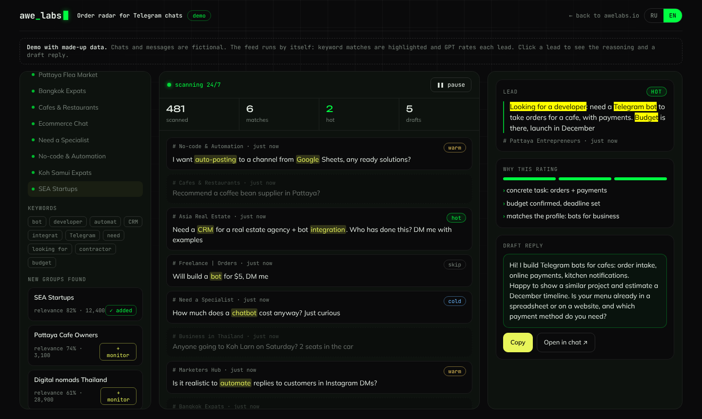
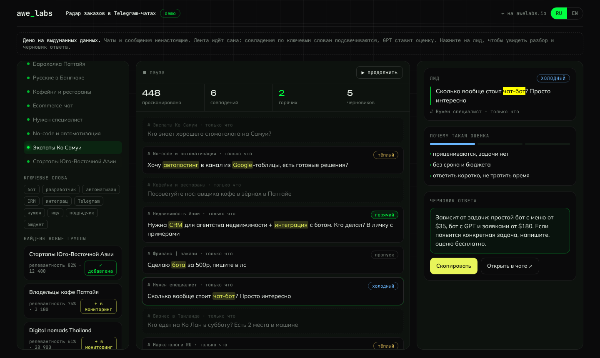

# AweLabs - Order radar for Telegram chats (demo)

**Live demo:** https://awelabs.io/demo/radar/

[English](#english) · [Русский](#русский)

## English

A front-end demo of a radar that watches dozens of niche Telegram chats and brings hot requests before competitors see them.

> **Demo with made-up data.** Chats, messages and people are fictional. The production code is not published.

### What the real radar does
- **Monitors 15+ chats 24/7** by keywords.
- **GPT rates every match:** hot, warm, cold - or skip (offers from competitors, spam).
- **Explains the rating** - task, budget, deadline, fit with the profile.
- **Drafts a personal reply** for hot and warm leads, ready to copy.
- **Finds new relevant groups** on its own and suggests adding them to monitoring.
- Hot leads go straight to the owner's Telegram.

### What the demo shows
A live feed: off-topic messages fade out, keyword matches are highlighted, GPT puts a rating on each. Click a lead to see the reasoning and the draft. On the left - monitored chats, keywords and newly found groups you can add. Pause / resume, RU / EN.

One static `index.html`, no build, no backend.

---

## Русский

Фронт-демо радара, который следит за десятками профильных Telegram-чатов и приносит горячие заявки раньше конкурентов.

> **Демо на выдуманных данных.** Чаты, сообщения и люди ненастоящие. Рабочий код не публикуется.

### Что умеет настоящий радар
- **Мониторинг 15+ чатов 24/7** по ключевым словам.
- **GPT оценивает каждое совпадение:** горячий, тёплый, холодный или пропуск (предложения конкурентов, спам).
- **Объясняет оценку** - задача, бюджет, срок, совпадение с профилем.
- **Готовит персональный черновик ответа** для горячих и тёплых лидов.
- **Сам находит новые релевантные группы** и предлагает добавить их в мониторинг.
- Горячие лиды сразу приходят владельцу в Telegram.

### Что показывает демо
Живая лента: сообщения не по теме гаснут, совпадения по ключевым словам подсвечиваются, GPT ставит оценку. По клику на лид - разбор и черновик. Слева - чаты в мониторинге, ключевые слова и найденные группы, которые можно добавить. Пауза, RU / EN.

Один статичный `index.html`, без сборки и бэкенда.

---

**AweLabs** - automation studio · [awelabs.io](https://awelabs.io) · [t.me/awe_labs](https://t.me/awe_labs)
